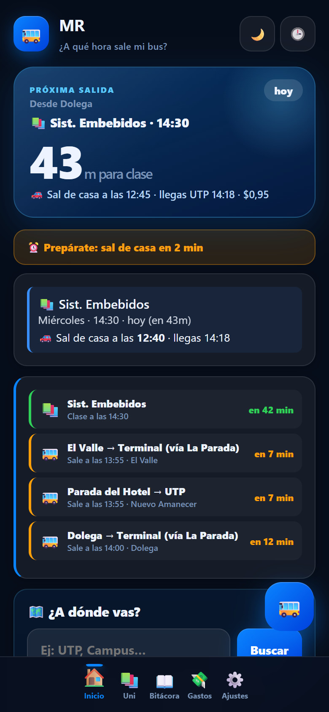
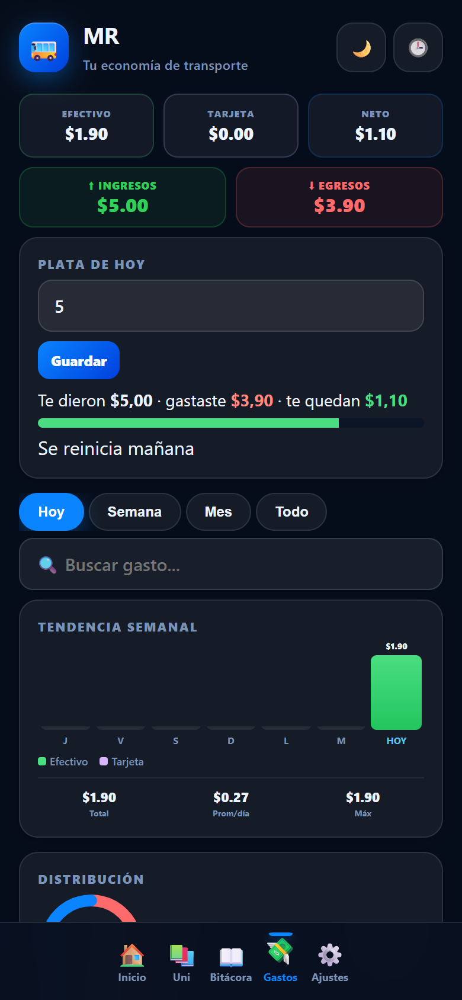
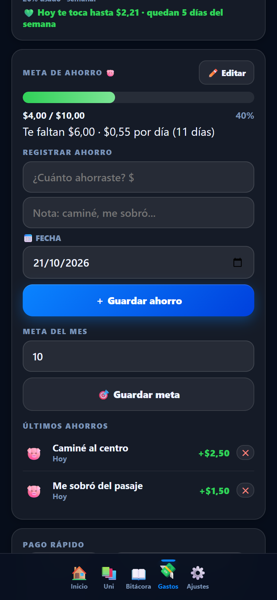
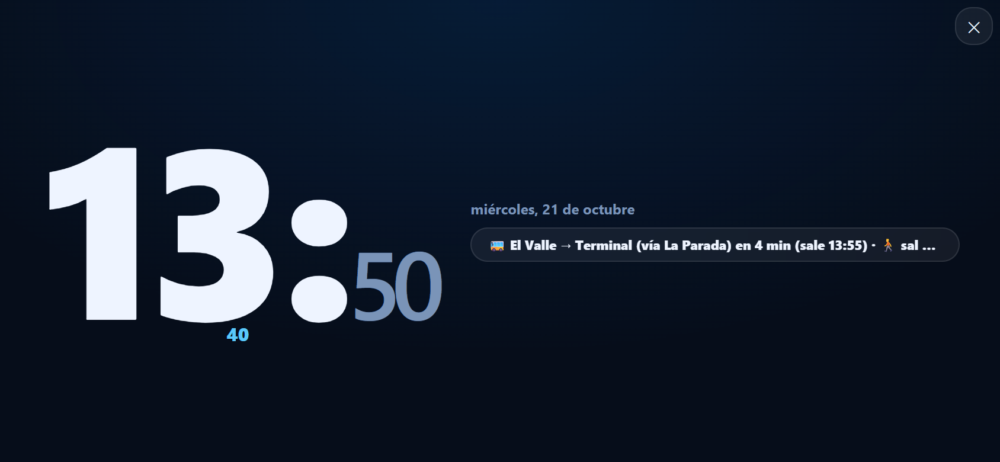

<div align="center">


# MR · Buses Chiriquí

**Horarios, rutas y gastos de transporte para estudiantes que viven lejos de la UTP.**

[](https://magdalenagonzalez08.github.io/mr-buses/)
[](https://github.com/magdalenagonzalez08/mr-buses/releases/latest)
[](https://magdalenagonzalez08.github.io/mr-buses/)
[](#tecnologías)

</div>

MR nació para resolver una pregunta que se repite todas las mañanas: **¿a qué hora sale el bus y cuánto me cuesta llegar?** Reúne los horarios de las rutas de Chiriquí, calcula cuándo salir de casa y lleva la cuenta de lo que gastas en transporte.

<div align="center">

</div>

## Qué hace

- **Próxima salida**: cuenta regresiva al bus y aviso de cuándo salir de casa.
- **Planificador de viaje**: compara rutas con transbordos y elige la más barata.
- **Gastos de transporte**: buses, taxis y comida, con búsqueda e historial por día.
- **Plata del día**: lo que te dieron, lo que gastaste y lo que te queda.
- **Presupuesto semanal**: barra de avance y cuánto puedes gastar por día.
- **Meta de ahorro**: registra lo que ahorras, con fecha y opción de deshacer.
- **Horario de clases**: te dice a qué hora salir para llegar a la UTP.
- **Bitácora y notas**: viajes, caminatas y apuntes del día.
- **Modo reloj**: pantalla gigante en horizontal al girar el celular.
- **Modo oscuro/claro** y cinco colores de acento.

## Capturas

| Gastos | Meta de ahorro |
|:---:|:---:|
|  |  |

<div align="center">

</div>

## Rutas y precios

| Ruta | Precio | Frecuencia |
|------|-------:|-----------|
| Dolega → Terminal | $0.60 | cada 15 min |
| Boquete → Terminal | $0.60 | cada 30 min |
| Potrerillos → Terminal | $0.60 | cada 45 min |
| Palmira → Terminal | $0.60 | cada 60 min |
| Tinajas → Terminal | $0.60 | cada 60 min |
| Las Cañas → Terminal | $0.60 | cada 60 min |
| Dos Ríos → Terminal | $0.60 | cada 30 min |
| El Valle → Terminal | $0.60 | cada 30 min |
| Los Algarrobos → Terminal | $0.60 | cada 30 min |
| Lassonde (Parada del Hotel) → UTP | $0.35 | cada 30 min |
| Nuevo Amanecer (Parada del Hotel) → UTP | $0.35 | cada 20 min |
| Bugaba → La Bomba | $0.35 | cada 15 min |
| Taxi a la Óptica o Farmacia | $1.00 | cuando quieras |
| Uber / inDriver Terminal → UTP | $3.00 a $5.00 | cuando quieras |

Los horarios y precios son aproximados. Si ves uno desactualizado, abre un issue con la corrección.

## Cómo llegar a la UTP

**Opción 1, directo:** Lassonde o Nuevo Amanecer en la Parada del Hotel hasta la UTP ($0.35).

**Opción 2, la más barata:** Bugaba hasta La Bomba ($0.35) y caminas 9 minutos.

**Opción 3, con transbordo:** Dolega o Boquete hasta la Terminal ($0.60), caminata a la Parada del Hotel y bus a la UTP ($0.35).

## Instalar

### Android (APK)

1. Entra a [Releases](https://github.com/magdalenagonzalez08/mr-buses/releases/latest).
2. Descarga `MR-Buses-v4.9.1.apk`.
3. Ábrelo en el celular y acepta la instalación.

Al instalar una versión nueva encima de la anterior no se pierden los datos.

### Navegador

Abre **https://magdalenagonzalez08.github.io/mr-buses/** desde el celular o la computadora.

### Como aplicación (PWA)

En Chrome: menú de tres puntos → **Instalar aplicación** o **Agregar a pantalla de inicio**. Queda con su propio icono y funciona sin internet.

## Tus datos son tuyos

Todo se guarda en el almacenamiento del navegador o del celular. No hay cuentas, servidores ni rastreadores. Desde Ajustes puedes exportar un respaldo en JSON y volver a importarlo cuando cambies de teléfono.

## Tecnologías

- HTML, CSS y JavaScript puro, sin frameworks ni dependencias.
- Service Worker para funcionar sin conexión.
- PWA instalable con manifest e icono.
- App Android en Kotlin con WebView, firmada para distribuir el APK.
- GitHub Actions compila y publica el APK en cada etiqueta de versión.

## Estructura

```
index.html      toda la app (HTML, CSS y JavaScript)
manifest.json   configuración de la PWA
sw.js           caché para uso sin conexión
icon.svg        icono de la app
docs/           capturas para el README
android/        proyecto Android (WebView y firma)
.github/        flujo de compilación del APK
```

## Créditos

Hecha por **Magdalena González** en Chiriquí, Panamá. Si te sirve, compártela con alguien que también viva lejos de la UTP.
